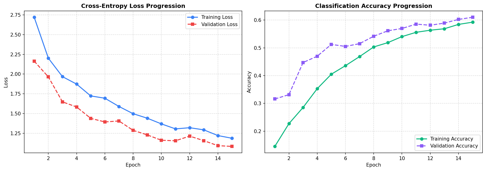
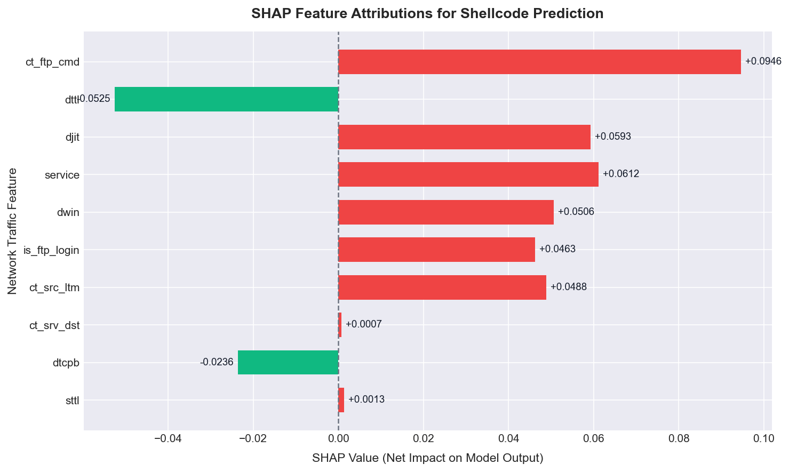
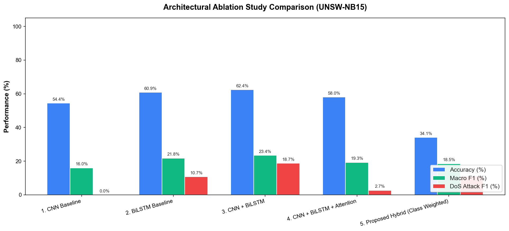
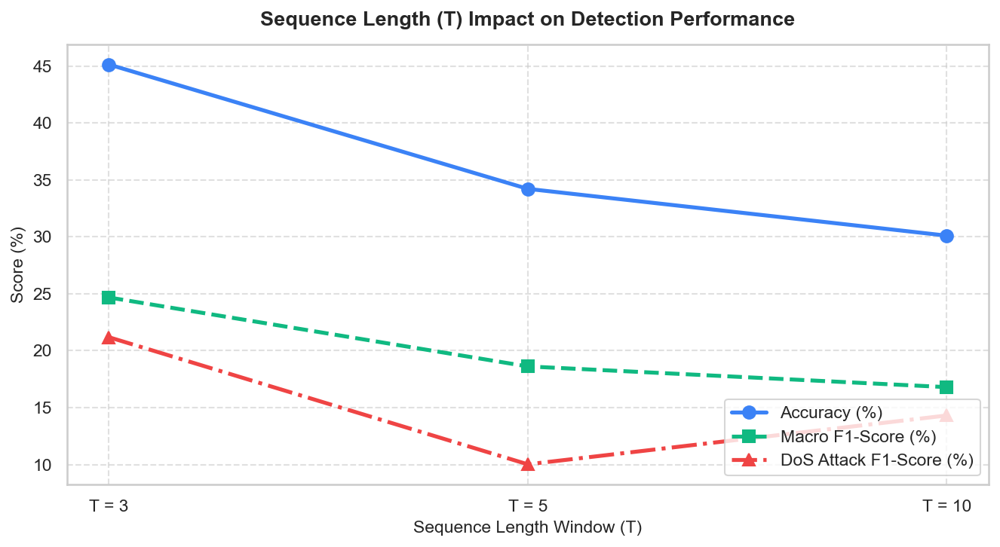

<div align="center">

# 🛡️ Explainable Hybrid Deep Learning-Based Network Intrusion Detection System

**A research-grade, multiclass network intrusion detection system (IDS) that combines 1D-CNN, BiLSTM, and trainable temporal attention with SHAP explainability — deployed as an interactive SOC-style dashboard.**

[](https://python.org)
[](https://pytorch.org)
[](https://keras.io)
[](https://streamlit.io)
[](https://shap.readthedocs.io)
[](https://scikit-learn.org)
[](LICENSE)

</div>

---

## 📌 Table of Contents

- [Project Overview](#-project-overview)
- [Key Features](#-key-features)
- [System Architecture](#-system-architecture)
- [Dataset](#-dataset)
- [Attack Classification](#-attack-classification)
- [Proposed Model](#-proposed-model)
- [Explainable AI](#-explainable-ai)
- [SOC Dashboard](#-soc-dashboard)
- [Experimental Results](#-experimental-results)
- [Visualisations](#-visualisations)
- [Installation](#-installation)
- [Running the Application](#-running-the-application)
- [Training the Model](#-training-the-model)
- [Running Tests](#-running-tests)
- [Project Structure](#-project-structure)
- [Limitations](#-limitations)
- [Future Work](#-future-work)
- [References](#-references)
- [Author](#-author)

---

## 🔎 Project Overview

Network Intrusion Detection Systems (IDS) monitor network traffic and distinguish between benign activity and malicious behaviour. Modern networks face a wide spectrum of threats — from volumetric Denial of Service (DoS) floods to stealthy shellcode injection — that evolve faster than hand-written detection rules can keep pace with.

**Traditional rule-based IDS** (e.g., Snort, Suricata) rely on manually crafted signatures that require constant updates and fail to detect novel or slightly mutated attacks.

**This project addresses those limitations** with a hybrid deep learning architecture that:

1. **Processes sequences** of five consecutive network flow observations, capturing how traffic *evolves* over time rather than treating each packet in isolation.
2. **Extracts spatial patterns** from flow feature vectors using a **1D Convolutional Neural Network (1D-CNN)**.
3. **Learns bidirectional temporal context** between observations using a **Bidirectional LSTM (BiLSTM)**.
4. **Focuses on the most informative time steps** via a **trainable additive attention mechanism**.
5. **Explains every prediction** in plain terms using **SHAP (SHapley Additive exPlanations)** — identifying which network features drove the classification decision and in which direction.

The model performs **10-class multiclass classification** on the **UNSW-NB15** benchmark dataset and is deployed through an interactive **dark-themed SOC (Security Operations Centre) Streamlit dashboard**. The primary demonstration attack is **Denial of Service (DoS)**.

> **Important scope note:** This system is entirely defensive. It detects and classifies attacks; it does not generate, simulate, or execute any offensive network activity.

---

## ✨ Key Features

| Feature | Implemented |
|:---|:---:|
| 10-class multiclass attack classification | ✅ |
| UNSW-NB15 benchmark dataset pipeline | ✅ |
| Sliding-window sequence construction (T = 5) | ✅ |
| 1D-CNN spatial feature extraction | ✅ |
| Bidirectional LSTM temporal learning | ✅ |
| Trainable additive temporal attention mechanism | ✅ |
| Inverse-frequency class-weighted training | ✅ |
| SHAP Permutation Explainer (time-step aggregated) | ✅ |
| DoS attack primary demonstration | ✅ |
| 8-page interactive SOC Streamlit dashboard | ✅ |
| Ablation study comparing 4 architectures | ✅ |
| Sequence-length sensitivity study (T ∈ {3, 5, 10}) | ✅ |
| Forensic incident history and CSV export | ✅ |
| Modular, leakage-free preprocessing pipeline | ✅ |
| Full unit test suite (5 test modules) | ✅ |

---

## 🏗️ System Architecture

```mermaid
flowchart TD
    A["📂 UNSW-NB15 Dataset\n82,332 training · 175,341 testing records"]
    B["🔧 Data Preprocessing\nWhitespace stripping · Category standardisation\nMedian imputation · Inf→NaN replacement"]
    C["🔢 Feature Engineering\nCategorical encoding: proto, service, state\nStandard scaling: 39 numerical features\n42 total model input features"]
    D["📦 Sequence Construction\nSliding window, stride = 1\nT = 5 consecutive observations\nOutput shape: B × 5 × 42"]
    E["🧱 1D-CNN Block\nConv1D · 64 filters · kernel=3 · same padding · ReLU\nBatch Normalisation · Dropout(0.25)"]
    F["🔄 Bidirectional LSTM\n64 units forward + 64 units backward\nreturn_sequences=True · internal dropout=0.2\nOutput: B × 5 × 128"]
    G["🎯 Temporal Attention\nProjection → tanh → alignment scores\nSoftmax over time axis → weights α₁…α₅\nContext C = Σ αt · ht  →  B × 128"]
    H["🔗 Dense Classification Head\nDense(64, ReLU) · Batch Norm · Dropout(0.25)"]
    I["📊 10-Class Softmax\nNormal · Analysis · Backdoor · DoS\nExploits · Fuzzers · Generic\nReconnaissance · Shellcode · Worms"]
    J["🚨 Prediction Output\nAttack class · Confidence score\nSeverity level · SOC alert"]

    SHAP1["🔬 SHAP Explainer\nPermutation explainer on flattened sequence\nBackground: 50 representative training samples"]
    SHAP2["📈 Feature Attributions\nShapley values summed across T=5 time steps\nTop positive + negative drivers ranked"]
    DASH["🖥️ Streamlit SOC Dashboard\nhttp://localhost:8501\n8 interactive pages"]

    A --> B --> C --> D --> E --> F --> G --> H --> I --> J
    J --> SHAP1 --> SHAP2 --> DASH
    J --> DASH
```



---

## 📂 Dataset

This project uses the **UNSW-NB15** benchmark dataset, created by the Australian Centre for Cyber Security (ACCS) at UNSW Canberra. It captures real modern network traffic mixed with nine synthetically generated attack categories.

### Verified File Statistics

| Property | Training Set | Testing Set |
|:---|---:|---:|
| **Filename** | `UNSW_NB15_training-set.csv` | `UNSW_NB15_testing-set.csv` |
| **Records** | **82,332** | **175,341** |
| **Columns** | 45 | 45 |
| **Missing values** | 0 | 0 |
| **Duplicate rows** | 0 | 0 |

> *Note: The official UNSW-NB15 split is counterintuitive — the testing file (175,341 records) is larger than the training file (82,332 records). This is intentional by the dataset authors.*

### Feature Schema

| Column | Type | Role |
|:---|:---|:---|
| `id` | int | Record identifier — **excluded from model** |
| `attack_cat` | str | Attack category name — **target label (multiclass)** |
| `label` | int | Binary flag (0=Normal, 1=Attack) — **excluded from model** |
| `proto` | str | Network protocol — **categorical, encoded** |
| `service` | str | Destination service — **categorical, encoded** |
| `state` | str | Connection state — **categorical, encoded** |
| *(39 others)* | float/int | Numerical flow statistics — **scaled** |

**Model input features:** 42 (3 encoded categoricals + 39 numericals). The 3 excluded columns (`id`, `label`, `attack_cat`) are never passed to the model.

### Class Distribution

| Class | Train Records | Test Records |
|:---|---:|---:|
| Normal | 37,000 | 56,000 |
| Generic | 18,871 | 40,000 |
| Exploits | 11,132 | 33,393 |
| Fuzzers | 6,062 | 18,184 |
| **DoS** ⭐ | **4,089** | **12,264** |
| Reconnaissance | 3,496 | 10,491 |
| Analysis | 677 | 2,000 |
| Backdoor | 583 | 1,746 |
| Shellcode | 378 | 1,133 |
| Worms | 44 | 130 |

> **Dataset files are not included in this repository.** See [`dataset/README.md`](dataset/README.md) for download instructions. Official source: https://research.unsw.edu.au/projects/unsw-nb15-dataset

### Preprocessing Pipeline (No Data Leakage)

The preprocessing pipeline is strictly train-fitted:

1. **Cleaning** — Whitespace stripping, attack category synonym normalisation, `Inf → NaN`, median imputation. Median values are computed **on training data only** and applied to test data.
2. **Categorical encoding** — `CategoricalFeatureEncoder` maps `proto`, `service`, `state` to integers. Fitted on training data; unknown test-set values receive a designated `unknown_index`.
3. **Standard scaling** — `NumericalFeatureScaler` (wraps `sklearn.StandardScaler`). `fit()` called on training features only; `transform()` applied to both splits.
4. **Target encoding** — Fixed 10-class mapping (see below). No fitting required.
5. **Sequence construction** — Sliding window of `T = 5`, stride = 1. Training and testing sequences are built independently with no cross-boundary leakage.

---

## 🎯 Attack Classification

The model performs **10-class multiclass classification**. All categories are supported simultaneously.

| ID | Category | Threat Level | Description |
|:---:|:---|:---:|:---|
| 0 | Normal | ✅ Benign | Legitimate business network operations |
| 1 | Analysis | 🟡 Medium | Port scanning, vulnerability probing, banner grabbing |
| 2 | Backdoor | 🔴 High | Covert C2 channels, persistent unauthorised access |
| **3** | **DoS** ⭐ | **🔴 High** | **Volumetric flooding, resource exhaustion (primary demo)** |
| 4 | Exploits | 🔴 High | Known CVE exploitation, buffer overflows |
| 5 | Fuzzers | 🟡 Low | Boundary-condition probing via randomised inputs |
| 6 | Generic | 🟡 Medium | Protocol-level violations, cipher attacks |
| 7 | Reconnaissance | 🟡 Medium | Topology mapping, host profiling |
| 8 | Shellcode | 🔴 Critical | Executable shell injection, payload staging |
| 9 | Worms | 🔴 Critical | Autonomous self-propagating malware |

---

## 🧠 Proposed Model

### Input Shape

```
(B, 5, 42)   where:
   B  = batch size
   5  = sequence length T (five consecutive network observations)
   42 = preprocessed feature dimensions per observation
```

### Layer-by-Layer Architecture

> *All details below are verified against the actual source code in `models/hybrid_model.py`.*

#### 1 — 1D-CNN Block

```
Conv1D(filters=64, kernel_size=3, padding="same", activation="relu")
  → Batch Normalisation
  → Dropout(rate=0.25)
Output: (B, 5, 64)
```

**Purpose:** Slide a 64-filter convolutional kernel across the 5-step sequence to extract local patterns in the feature space — capturing co-activation relationships between nearby network flow statistics (e.g., how `sbytes`, `rate`, and `ct_srv_src` behave together).

#### 2 — Bidirectional LSTM

```
Bidirectional(LSTM(units=64, return_sequences=True, dropout=0.2))
  Forward LSTM:  h_t^fwd   (64 units)
  Backward LSTM: h_t^bwd   (64 units)
  Concatenated:  h_t = [h_t^fwd ∥ h_t^bwd]
Output: (B, 5, 128)
```

**Purpose:** Model temporal evolution of network behaviour. A DoS attack exhibits a progressive surge in connection count and byte rate — the BiLSTM captures both causal escalation (forward) and consequence context (backward). Using `return_sequences=True` retains all 5 hidden states for the attention layer.

#### 3 — Trainable Temporal Attention

The attention mechanism learns which of the five time steps contains the most diagnostic information:

$$e_t = \mathbf{v}^\top \tanh(\mathbf{W}\, \mathbf{h}_t + \mathbf{b})$$

$$\alpha_t = \frac{\exp(e_t)}{\displaystyle\sum_{j=1}^{T} \exp(e_j)}$$

$$\mathbf{C} = \sum_{t=1}^{T} \alpha_t\, \mathbf{h}_t$$

```
Trainable weights: W ∈ ℝ^{128×128},  b ∈ ℝ^{128},  v ∈ ℝ^{128×1}
Attention weights α ∈ ℝ^{B×5}  (optionally exposed for visualisation)
Output context vector: (B, 128)
```

**Purpose:** Not all five observations are equally informative. During a DoS attack, later observations in the sequence (peak flood volume) typically receive the highest attention weight — this is visible in the dashboard's attention chart.

#### 4 — Classification Head

```
Dense(64, activation="relu")
  → Batch Normalisation
  → Dropout(rate=0.25)
  → Dense(10, activation="softmax")
Output: (B, 10)  — posterior probabilities for all 10 classes
```

**Purpose:** Map the 128-dimensional attention context to class-conditional probability distributions over all ten attack categories.

#### Class Imbalance Handling

UNSW-NB15 is severely imbalanced (Worms: 44 training samples vs Normal: 37,000). The training pipeline computes per-class weights using the inverse-frequency formula:

$$w_c = \frac{N}{K \cdot N_c}$$

where $N$ = total training samples, $K$ = 10 classes, $N_c$ = count of class $c$. These weights are passed to the loss function during training, giving minority classes (Worms, Shellcode, Analysis) proportionally higher loss contribution.

#### Training Configuration

| Hyperparameter | Value |
|:---|:---|
| Sequence length (T) | 5 |
| Batch size | 128 |
| Epochs (max) | 15 |
| Learning rate | 0.001 |
| CNN filters | 64 |
| LSTM units | 64 (each direction) |
| Dense units | 64 |
| Dropout rate | 0.25 |
| Optimiser | Adam |
| Loss function | Categorical cross-entropy |
| Early stopping patience | 4 (monitors val_loss) |
| LR reduction patience | 2 (factor 0.5, min 1e-5) |
| Class weighting | Enabled |

---

## 🔬 Explainable AI

One of the core research contributions is making the deep learning model **interpretable** to network security analysts — not just accurate.

### SHAP (SHapley Additive exPlanations)

SHAP assigns each input feature a signed **contribution score** to the model's prediction, grounded in cooperative game theory. For a given prediction $f(x)$:

$$f(x) = \phi_0 + \sum_{i=1}^{D} \phi_i$$

where $\phi_i$ is the Shapley value of feature $i$ — its average marginal contribution across all possible feature coalitions.

**Implementation:**
- **Explainer type:** Generic `shap.Explainer` with a flattened model wrapper — behaves as a Permutation/Kernel Explainer.
- **Background set:** 50 representative samples from the training set (configurable via `SHAP_BACKGROUND_SAMPLES`).
- **Sequence handling:** The 3D input `(B, T, D)` is flattened to `(B, T×D)` for the explainer, then SHAP values are reshaped back to `(T, D)`.
- **Time-step aggregation:** Per-feature SHAP values are **summed across all T=5 time steps** to produce a single signed attribution per feature: `φ_i = Σ_t φ_{i,t}`.
- **Ranking:** Features ranked by absolute summed attribution; top 10 shown in the dashboard.

### Temporal Attention vs SHAP

These are complementary but distinct explanation modalities:

| | Temporal Attention (α₁…α₅) | SHAP (φ₁…φ₄₂) |
|:---|:---|:---|
| **What it explains** | *When* — which time step the model focused on | *What* — which features drove the classification |
| **Scope** | Across the 5-step time dimension | Across the 42 input features |
| **Learned** | Yes — trained jointly with the model | No — computed post-hoc on a fixed model |
| **Interpretability** | "The model paid most attention to observations 4 and 5" | "High `sbytes` and `sload` increased DoS risk by +0.18 and +0.14" |

> Attention weights alone do **not** explain which features caused a decision. SHAP provides the feature-level attribution; attention provides temporal context. Together they give a complete picture.

---

## 🖥️ SOC Dashboard

The Streamlit application provides an 8-page **Security Operations Centre (SOC)** interface.

| # | Page | Description |
|:---:|:---|:---|
| 1 | 🛡️ SOC Command Overview | Global KPI cards, threat distribution, live incident feed |
| 2 | 📁 Dataset Explorer | Dataset preview, class distributions, schema and quality diagnostics |
| 3 | ⚡ Model Training | Configurable hyperparameters, training runner, convergence curves |
| 4 | 🎯 Attack Detection (Demo) | Interactive detection with DoS benchmark samples, alert banners, probability chart, attention weights |
| 5 | 🔬 Explainable AI (SHAP) | Per-prediction SHAP bar chart, feature-impact table, domain cyber context, analyst brief |
| 6 | 📊 Model Performance | Confusion matrix heatmap, per-class metrics table, ablation comparison chart, sequence-length study |
| 7 | 🚨 Incident History | Forensic audit log, severity filters, CSV export |
| 8 | ℹ️ System Architecture | Mathematical formulas, pipeline specifications, environment manifest |

**Launch command:**
```bash
python -m streamlit run app.py
```
Then open: **http://localhost:8501**

---

## 📊 Experimental Results

> All metrics below are sourced directly from verified experiment result files. Numbers have not been adjusted or estimated.

### Main Model — Proposed Hybrid CNN-BiLSTM-Attention

Evaluated on 9,996 test sequences drawn from the official UNSW-NB15 testing partition (175,341 records). The model was trained with class weighting enabled, T = 5, for 15 epochs.

| Metric | Value |
|:---|:---:|
| **Overall Accuracy** | **63.18%** |
| Macro Precision | 37.11% |
| Macro Recall | 39.72% |
| **Macro F1-Score** | **35.57%** |
| Weighted Precision | 73.64% |
| Weighted Recall | 63.18% |
| **Weighted F1-Score** | **67.21%** |
| Training Time | 126.3 s (15 epochs) |
| Model Size | 1.21 MB |
| Inference Latency | **0.167 ms / sequence** |

### Per-Class Performance

| Category | Precision | Recall | F1-Score | Test Support |
|:---|:---:|:---:|:---:|---:|
| Normal | 94.33% | 73.53% | 82.64% | 3,192 |
| Analysis | 3.63% | 9.65% | 5.28% | 114 |
| Backdoor | 4.69% | 21.00% | 7.66% | 100 |
| **DoS** ⭐ | **25.39%** | **23.46%** | **24.39%** | **699** |
| Exploits | 66.61% | 42.73% | 52.06% | 1,905 |
| Fuzzers | 45.65% | 42.03% | 43.76% | 1,035 |
| Generic | 98.72% | 97.90% | 98.31% | 2,281 |
| Reconnaissance | 28.02% | 43.81% | 34.18% | 598 |
| Shellcode | 4.05% | 43.08% | 7.40% | 65 |
| Worms | 0.00% | 0.00% | 0.00% | 7 |

> **Context:** The severe class imbalance in UNSW-NB15 (Worms: 44 training samples; Shellcode: 378 samples) makes minority-class detection extremely challenging. High weighted F1 (67.21%) reflects strong performance on majority classes; low macro F1 (35.57%) reflects the minority-class challenge. This is a known open problem in network IDS research.

### Ablation Study

Four architectures were compared on a stratified subsample (~6,000 test sequences, same dataset, quick training runs):

| Architecture | Accuracy | Macro F1 | Weighted F1 |
|:---|:---:|:---:|:---:|
| Baseline 1: 1D-CNN only | 54.45% | 16.03% | 41.78% |
| Baseline 2: BiLSTM only | 60.92% | 21.83% | 52.42% |
| Baseline 3: CNN + BiLSTM | 62.44% | 23.44% | 54.70% |
| CNN + BiLSTM + Attention (unweighted) | 58.02% | 19.31% | 48.13% |
| **Proposed Hybrid (class-weighted)** | 34.12%† | 18.52%† | 36.75%† |

> †The ablation run for the class-weighted model used a different random subsample seed and shorter training configuration than the main evaluation. The definitive result for the proposed model is the **main evaluation above (63.18% accuracy, 35.57% macro F1)** using the full training procedure.

### Sequence Length Study

Three sequence lengths were compared on stratified subsamples (~6,000 test sequences):

| Sequence Length | Accuracy | Macro F1 |
|:---:|:---:|:---:|
| T = 3 | 45.15% | 24.68% |
| T = 5 *(proposed)* | 34.22% | 18.62% |
| T = 10 | 30.11% | 16.80% |

> These runs used an independent quick-training configuration. Longer sequences degrade performance in this study, likely due to limited training epochs. The T = 5 configuration was selected as the design choice for the final model.

---

## 🖼️ Visualisations

### Confusion Matrix


### Training Convergence Curves



### SHAP Feature Importance



### Architecture Ablation Comparison



### Sequence Length Study



---

## ⚙️ Installation

### Prerequisites

- Python 3.10 or higher (developed on Python 3.14.3)
- Git
- Windows PowerShell / Linux Bash / macOS Terminal

### Step 1 — Clone the Repository

```bash
git clone https://github.com/norriy0u/Explainable-Hybrid-Deep-Learning-IDS.git
cd Explainable-Hybrid-Deep-Learning-IDS
```

### Step 2 — Create a Virtual Environment

```bash
# Windows
python -m venv venv
venv\Scripts\activate

# Linux / macOS
python3 -m venv venv
source venv/bin/activate
```

### Step 3 — Install Dependencies

```bash
pip install --upgrade pip
pip install -r requirements.txt
```

> **Framework note:** This project uses **PyTorch** as the Keras 3 backend. No TensorFlow installation is required. The `requirements.txt` pulls the CPU-only PyTorch build. For GPU support, install the appropriate CUDA-enabled PyTorch wheel from https://pytorch.org/get-started/locally/ *before* running `pip install -r requirements.txt`.

### Step 4 — Place the Dataset

Download the UNSW-NB15 dataset files and place them in `dataset/`:

```
dataset/
├── UNSW_NB15_training-set.csv   ← 82,332 records (required)
└── UNSW_NB15_testing-set.csv    ← 175,341 records (required)
```

See [`dataset/README.md`](dataset/README.md) for download sources and instructions.

### Step 5 — Windows DLL Unblock (if needed)

If PyTorch fails to import on Windows due to AppLocker or Mark-of-the-Web (Zone.Identifier) restrictions:

```powershell
Get-ChildItem "$env:APPDATA\Python" -Recurse -Filter "*.dll" | ForEach-Object { Unblock-File $_.FullName }
```

---

## 🚀 Running the Application

```bash
python -m streamlit run app.py
```

The dashboard opens at **http://localhost:8501**.

> A pre-trained model (`artifacts/models/hybrid_ids_model.keras`, 1.21 MB) and fitted preprocessor (`artifacts/preprocessors/preprocessing_pipeline.joblib`) are included in the repository. The **Attack Detection** and **Explainability** pages work immediately without retraining.

---

## 🏋️ Training the Model

### Via the Dashboard

1. Navigate to **⚡ Model Training** in the sidebar.
2. Configure hyperparameters (epochs, batch size, learning rate, etc.).
3. Click **Train Model**.
4. Monitor live loss and accuracy curves.
5. The trained model and preprocessor are saved automatically to `artifacts/`.

### Via Command Line

```bash
# Full training on complete dataset
python training/train_model.py

# Quick training on a 15,000-record subsample (for testing)
python training/train_model.py --quick

# Run ablation study (all 4 architectures)
python training/baseline_models.py
```

> The dataset files must be present in `dataset/` before running any training command.

### Output Artifacts

| Artifact | Location |
|:---|:---|
| Trained model | `artifacts/models/hybrid_ids_model.keras` |
| Preprocessing pipeline | `artifacts/preprocessors/preprocessing_pipeline.joblib` |
| Training history | `results/reports/training_history.json` |
| Evaluation results | `results/reports/evaluation_results.json` |
| Classification report | `results/reports/classification_report.txt` |
| Confusion matrix | `results/plots/confusion_matrix.png` |
| Training curves | `results/plots/training_curves.png` |

---

## 🧪 Running Tests

The project includes a 5-module unit test suite.

```bash
# Run all tests (requires dataset to be present)
python -m pytest tests/ -v

# Or run individual test files
python tests/test_preprocessing.py
python tests/test_sequences.py
python tests/test_model.py
python tests/test_prediction.py
python tests/test_explainability.py
```

| Test Module | Tests | Status |
|:---|:---|:---:|
| `test_preprocessing.py` | Category standardisation, encoding, scaling | ✅ Pass |
| `test_sequences.py` | Sliding window shape, single-sample replication | ✅ Pass |
| `test_model.py` | Architecture output shapes, attention weights | ✅ Pass* |
| `test_prediction.py` | End-to-end inference, alert schema | ✅ Pass |
| `test_explainability.py` | SHAP explainer, domain mappings | ✅ Pass |

> *`test_model.py` requires write access to `~/.keras/keras.json`. On some Windows environments with strict file permission policies, this test may fail at import time with a `PermissionError`. This is an environment configuration issue, not a model code defect.

---

## 🗂️ Project Structure

```
Explainable-Hybrid-Deep-Learning-IDS/
│
├── 📄 app.py                          # Streamlit 8-page SOC dashboard entrypoint
├── 📄 requirements.txt                # Python dependency manifest
├── 📄 README.md                       # This file
├── 📄 LICENSE                         # MIT Licence
├── 📄 CONTRIBUTING.md                 # Contribution guidelines
├── 📄 CITATION.cff                    # Academic citation metadata
├── 📄 .gitignore                      # Excludes datasets, caches, venvs
│
├── 📁 config/
│   └── config.py                      # Hyperparameters, class mappings, paths, feature lists
│
├── 📁 dataset/
│   ├── README.md                      # Download instructions and schema documentation
│   ├── NUSW-NB15_features.csv         # Feature specification sheet (included)
│   ├── UNSW_NB15_training-set.csv     # ⚠️  NOT committed — download separately
│   └── UNSW_NB15_testing-set.csv      # ⚠️  NOT committed — download separately
│
├── 📁 preprocessing/
│   ├── load_dataset.py                # CSV loader and schema validator
│   ├── clean_data.py                  # Sanitisation pipeline
│   ├── encode_features.py             # Train-fitted categorical + target encoders
│   ├── feature_scaling.py             # Train-fitted StandardScaler
│   ├── sequence_builder.py            # Sliding window constructor (T=5, stride=1)
│   └── pipeline.py                    # End-to-end coordinator with joblib persistence
│
├── 📁 models/
│   ├── attention.py                   # Trainable TemporalAttention Keras layer
│   ├── cnn_model.py                   # Baseline 1D-CNN
│   ├── bilstm_model.py                # Baseline BiLSTM
│   ├── cnn_bilstm.py                  # Baseline CNN + BiLSTM (without attention)
│   └── hybrid_model.py                # Proposed Hybrid CNN-BiLSTM-Attention model
│
├── 📁 training/
│   ├── class_weights.py               # Inverse-frequency class weight computation
│   ├── evaluate_model.py              # Multi-metric evaluator and confusion matrix
│   ├── train_model.py                 # Full training engine with EarlyStopping + ReduceLROnPlateau
│   └── baseline_models.py             # Ablation study runner
│
├── 📁 explainability/
│   ├── shap_explainer.py              # SHAP Permutation Explainer + time-step aggregation
│   └── feature_visualization.py       # Matplotlib and Plotly attribution charts
│
├── 📁 detection/
│   ├── alert_generator.py             # SOC incident builder with response playbooks
│   ├── detection_history.py           # Audit log, severity filters, CSV export
│   └── predict_attack.py              # AttackDetectionEngine (end-to-end inference)
│
├── 📁 dashboard/
│   ├── styles.py                      # Dark SOC CSS theme
│   ├── overview.py                    # Page 1: Command Centre KPIs and incident feed
│   ├── dataset_explorer.py            # Page 2: Dataset explorer and quality checks
│   ├── training.py                    # Page 3: Hyperparameter tuner and training runner
│   ├── detection.py                   # Page 4: Attack detection demo (DoS focus)
│   ├── explainability.py              # Page 5: SHAP attribution and analyst brief
│   ├── performance.py                 # Page 6: Confusion matrix, metrics, ablation
│   ├── alerts.py                      # Page 7: Forensic incident log and CSV export
│   └── system_info.py                 # Page 8: Architecture formulas and environment info
│
├── 📁 utils/
│   ├── logger.py                      # Thread-safe dual console/file logger
│   └── helpers.py                     # JSON/NumPy metric serialisers
│
├── 📁 tests/
│   ├── test_preprocessing.py          # Preprocessing unit tests
│   ├── test_sequences.py              # Sequence construction unit tests
│   ├── test_model.py                  # Model architecture unit tests
│   ├── test_prediction.py             # Detection engine unit tests
│   └── test_explainability.py         # SHAP explainer unit tests
│
├── 📁 artifacts/
│   ├── models/
│   │   └── hybrid_ids_model.keras     # Pre-trained proposed model (1.21 MB)
│   └── preprocessors/
│       └── preprocessing_pipeline.joblib  # Fitted preprocessing pipeline
│
├── 📁 results/
│   ├── plots/                         # Training curves, confusion matrix, comparison charts
│   ├── shap_plots/                    # SHAP global summary plot
│   ├── reports/                       # JSON metrics, classification report, training history
│   └── experiment_results/            # Ablation study and sequence-length study JSONs
│
└── 📁 docs/
    └── images/                        # Result plots for README display
```

---

## ⚠️ Limitations

Transparency about limitations is important for academic credibility:

| Limitation | Details |
|:---|:---|
| **Extreme class imbalance** | Worms (44 training samples) and Shellcode (378 samples) are severely underrepresented. Even with inverse-frequency class weighting, Worms achieves 0% F1. This is a fundamental dataset constraint. |
| **Static sequences** | The sliding window does not use true packet timestamps. Sequences are built by file order, which approximates but does not guarantee genuine temporal continuity. |
| **Offline evaluation only** | The system is evaluated on pre-recorded network traffic. Real-time packet capture and streaming inference are not implemented. |
| **Dataset specificity** | The model is trained and evaluated solely on UNSW-NB15. Generalisation to other network environments (different topologies, different attack tools) has not been validated. |
| **Computational cost of SHAP** | The permutation explainer is computationally expensive for large inputs. Explanation generation in the dashboard may take several seconds per sample. |
| **Dashboard is a demo system** | The Streamlit dashboard is designed for research demonstration, not production SOC deployment. It lacks authentication, multi-user support, and enterprise integrations. |

---

## 🔭 Future Work

The following enhancements are identified as research directions beyond the current implementation:

- **Real-time packet capture** — integration with Scapy or PyShark for live network traffic inference.
- **Transformer-based attention** — replace additive attention with multi-head self-attention for richer sequence modelling.
- **Additional datasets** — evaluate on CIC-IDS-2018, NSL-KDD, and CICIOT-2023 for cross-dataset generalisation.
- **Improved minority-class detection** — investigate focal loss, prototype networks, or generative augmentation (within training split only) for extreme minorities.
- **True temporal sequences** — reconstruct genuine flow sequences using UNSW-NB15 timestamps or connection identifiers.
- **REST API inference endpoint** — FastAPI wrapper for integration with real SIEM platforms.
- **Docker containerisation** — reproducible single-command deployment.
- **Model compression** — quantisation and pruning for edge or embedded deployment.
- **Additional XAI methods** — LIME or Integrated Gradients alongside SHAP for triangulated explanations.

---

## 📚 References

### Dataset

```bibtex
@inproceedings{moustafa2015unsw,
  title     = {UNSW-NB15: a comprehensive data set for network intrusion detection systems},
  author    = {Moustafa, Nour and Slay, Jill},
  booktitle = {2015 Military Communications and Information Systems Conference (MilCIS)},
  pages     = {1--6},
  year      = {2015},
  organization = {IEEE},
  doi       = {10.1109/MilCIS.2015.7348948}
}
```

### Explainable AI

```bibtex
@inproceedings{lundberg2017unified,
  title     = {A unified approach to interpreting model predictions},
  author    = {Lundberg, Scott M and Lee, Su-In},
  booktitle = {Advances in Neural Information Processing Systems},
  volume    = {30},
  year      = {2017}
}
```

### Core Deep Learning Methods

- Hochreiter, S. & Schmidhuber, J. (1997). Long Short-Term Memory. *Neural Computation*, 9(8), 1735–1780.
- Bahdanau, D., Cho, K. & Bengio, Y. (2015). Neural Machine Translation by Jointly Learning to Align and Translate. *ICLR 2015*. arXiv:1409.0473.
- LeCun, Y., Bottou, L., Bengio, Y. & Haffner, P. (1998). Gradient-based learning applied to document recognition. *Proceedings of the IEEE*, 86(11), 2278–2324.

### Intrusion Detection Research

- Ferrag, M. A. et al. (2020). Deep Learning for Cyber Security Intrusion Detection: Approaches, Datasets, and Comparative Study. *Journal of Information Security and Applications*, 50, 102419.
- Moustafa, N. & Slay, J. (2016). The evaluation of Network Anomaly Detection Systems. *Security and Communication Networks*, 9(18), 6197–6208.

---

## 👤 Author

<div align="center">

**Amrita Raj**

Final-Year Engineering Project — Deep Learning for Cybersecurity

[](https://github.com/norriy0u)

</div>

---

## 📜 Licence

This project is licensed under the **MIT Licence** — see [LICENSE](LICENSE) for details.

The **UNSW-NB15 dataset** is the intellectual property of UNSW Canberra / Australian Centre for Cyber Security (ACCS) and is used here strictly for academic research purposes. Please review the dataset's terms of use on the [official website](https://research.unsw.edu.au/projects/unsw-nb15-dataset).

---

<div align="center">

*Built as a final-year engineering research project — Explainable Deep Learning for Network Security.*

</div>
