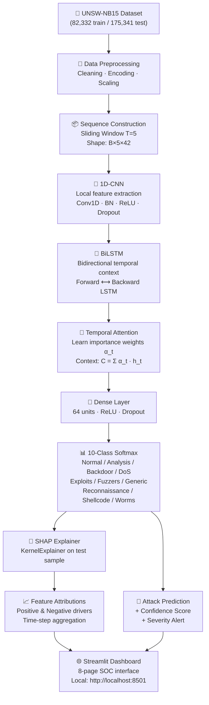

<div align="center">

# 🛡️ Explainable Hybrid Deep Learning-Based Network Intrusion Detection System

**An intelligent, explainable IDS that combines 1D-CNN, BiLSTM, temporal attention, and SHAP to classify network traffic into ten attack categories — with a dedicated DoS demonstration.**

[](https://python.org)
[](https://pytorch.org)
[](https://keras.io)
[](https://streamlit.io)
[](https://shap.readthedocs.io)
[](https://scikit-learn.org)
[](LICENSE)
[](https://research.unsw.edu.au/projects/unsw-nb15-dataset)

</div>

---

## 📌 Table of Contents

- [Project Overview](#-project-overview)
- [Key Features](#-key-features)
- [System Architecture](#-system-architecture)
- [Model Architecture Details](#-model-architecture-details)
- [Dataset](#-dataset)
- [Attack Classification](#-attack-classification)
- [Explainable AI — SHAP](#-explainable-ai--shap)
- [SOC Dashboard](#-soc-dashboard)
- [Installation](#-installation)
- [Running the Application](#-running-the-application)
- [Training the Model](#-training-the-model)
- [Model Evaluation Results](#-model-evaluation-results)
- [Project Structure](#-project-structure)
- [Testing](#-testing)
- [Future Work](#-future-work)
- [References](#-references)
- [Author](#-author)

---

## 🔎 Project Overview

Network Intrusion Detection Systems (IDS) are a cornerstone of modern cyber defence. They monitor network traffic and distinguish between benign activity and malicious behaviour — ranging from Denial of Service flooding to stealthy shellcode injection.

**Traditional rule-based IDS** (like Snort or Suricata) rely on hand-crafted signatures that must be constantly updated and fail to detect novel, zero-day attacks.

**Machine learning-based IDS** improve generalisation but most treat individual packets in isolation, ignoring the temporal and contextual structure of network flows.

**This project addresses both limitations** by proposing a hybrid deep learning architecture that:

1. **Extracts local spatial patterns** from network flow features using a **1D Convolutional Neural Network (1D-CNN)**.
2. **Learns bidirectional temporal dependencies** between consecutive network observations using a **Bidirectional LSTM (BiLSTM)**.
3. **Prioritises the most informative time steps** via a **trainable temporal attention mechanism**.
4. **Explains every prediction** using **SHAP (SHapley Additive exPlanations)** — identifying which network features drove the classification decision and by how much.

The result is a **10-class multiclass classifier** trained on the benchmark **UNSW-NB15** dataset, deployed through an interactive **dark-themed SOC (Security Operations Centre) Streamlit dashboard**, with a primary demonstration focus on **Denial of Service (DoS)** attack detection.

---

## ✨ Key Features

| Feature | Status |
|---|:---:|
| 10-class attack + normal traffic classification | ✅ |
| UNSW-NB15 benchmark dataset pipeline | ✅ |
| 1D-CNN spatial feature extraction | ✅ |
| Bidirectional LSTM temporal learning (T=5 sequences) | ✅ |
| Trainable temporal attention mechanism | ✅ |
| Inverse-frequency class-weighted training | ✅ |
| SHAP feature attribution (global + per-prediction) | ✅ |
| DoS attack primary demonstration | ✅ |
| Interactive dark SOC Streamlit dashboard (8 pages) | ✅ |
| Ablation study (5 architectures compared) | ✅ |
| Sequence length sensitivity study (T ∈ {3, 5, 10}) | ✅ |
| Forensic incident history & CSV export | ✅ |
| Modular, reproducible preprocessing pipeline | ✅ |
| Full unit test suite (5 test modules) | ✅ |

---

## 🏗️ System Architecture



---

## 🧠 Model Architecture Details

### Input Shape

```
(B, 5, 42)   where:
   B  = batch size
   5  = sequence length T (five consecutive network observations)
   42 = number of preprocessed numerical features per observation
```

### Module A — 1D Convolutional Neural Network

The 1D-CNN operates across the temporal sequence dimension to extract **local correlation patterns** between adjacent network flow features (e.g., byte counts, connection rates, protocol flags).

```
Conv1D(64 filters, kernel=3, padding='same')
  → Batch Normalization
  → ReLU Activation
  → SpatialDropout1D(0.2)
Output shape: (B, 5, 64)
```

**Purpose:** Capture feature-local spatial patterns that are independent of sequence position, reducing noise and compressing the 42-feature input into 64 learned representations.

---

### Module B — Bidirectional LSTM (BiLSTM)

The BiLSTM processes the CNN output sequences in **both forward and backward directions simultaneously**, capturing causal dependencies (what preceded an event) and reverse context (what followed).

```
Bidirectional(LSTM(64 units, return_sequences=True))
  → Forward LSTM:  h_fwd = [h_1^fwd, ..., h_T^fwd]
  → Backward LSTM: h_bwd = [h_1^bwd, ..., h_T^bwd]
  → Concatenate:   h_t = [h_t^fwd || h_t^bwd]
Output shape: (B, 5, 128)
```

**Purpose:** Model temporal evolution of network behaviour. A DoS attack exhibits a progressive surge in connection count and byte rate — both forward (escalation) and backward (consequence) context is needed to distinguish it from brief legitimate bursts.

---

### Module C — Trainable Temporal Attention

The attention mechanism learns which of the five time steps contains the most diagnostic information for classification.

$$e_t = \mathbf{v}^\top \tanh(\mathbf{W} \mathbf{h}_t + \mathbf{b})$$

$$\alpha_t = \frac{\exp(e_t)}{\sum_{j=1}^{T} \exp(e_j)} \quad \text{(Softmax normalization)}$$

$$\mathbf{C} = \sum_{t=1}^{T} \alpha_t \mathbf{h}_t \quad \text{(Weighted context vector)}$$

```
TemporalAttention Layer (custom, registered Keras serializable)
  Input:  (B, 5, 128)
  Output: (B, 128)  — attention-weighted context vector
  Optionally exposes: attention weights α ∈ ℝ^{B×5} for visualization
```

**Purpose:** Not all five observations in a sequence are equally informative. During a DoS attack, the final observation (peak flood volume) typically receives the highest attention weight, as demonstrated in the dashboard's attention chart.

---

### Module D — Classification Head

```
Dense(64, activation='relu')
  → Dropout(0.3)
  → Dense(10, activation='softmax')
Output: (B, 10) — posterior probabilities for all 10 classes
```

**Purpose:** Map the 128-dimensional attention context into class-conditional probability distributions over all ten attack categories.

---

## 📂 Dataset

This project uses the **UNSW-NB15** benchmark dataset, created by the Australian Centre for Cyber Security (ACCS) at UNSW Canberra.

| Property | Value |
|---|---|
| Training Records | **82,332** |
| Testing Records | **175,341** |
| Total | **257,673** |
| Input Features (model) | **42** (after removing `id`, `label`, `attack_cat`) |
| Categorical Features | `proto`, `service`, `state` (encoded) |
| Numerical Features | 39 flow statistics |
| Attack Classes | 10 (9 attack + 1 normal) |

> **Dataset files are not bundled in this repository.** See [`dataset/README.md`](dataset/README.md) for download instructions and expected file placement.

**Official download:** https://research.unsw.edu.au/projects/unsw-nb15-dataset

**Training set class distribution:**

| Class | Train Count | Test Count |
|---|---:|---:|
| Normal | 37,000 | 56,000 |
| Generic | 18,871 | 40,000 |
| Exploits | 11,132 | 33,393 |
| Fuzzers | 6,062 | 18,184 |
| **DoS** | **4,089** | **12,264** |
| Reconnaissance | 3,496 | 10,491 |
| Analysis | 677 | 2,000 |
| Backdoor | 583 | 1,746 |
| Shellcode | 378 | 1,133 |
| Worms | 44 | 130 |

---

## 🎯 Attack Classification

The system performs **10-class multiclass classification**. All categories are supported simultaneously — the model is not a binary or DoS-only classifier.

| ID | Category | Threat Level | Description |
|:---:|:---|:---:|:---|
| 0 | Normal | ✅ Benign | Legitimate business network operations |
| 1 | Analysis | 🟡 Medium | Port scanning, vulnerability probing, banner grabbing |
| 2 | Backdoor | 🔴 High | Covert C2 communication, persistent unauthorized access |
| **3** | **DoS** ⭐ | **🔴 High** | **Volumetric flooding, resource exhaustion (primary demo)** |
| 4 | Exploits | 🔴 High | Known software CVE exploitation, buffer overflows |
| 5 | Fuzzers | 🟡 Low | Boundary condition probing via randomized inputs |
| 6 | Generic | 🟡 Medium | Protocol-level violations, cipher attacks |
| 7 | Reconnaissance | 🟡 Medium | Topology mapping, host profiling, OSINT |
| 8 | Shellcode | 🔴 Critical | Executable shell injection, payload staging |
| 9 | Worms | 🔴 Critical | Autonomous self-propagating malware |

---

## 🔬 Explainable AI — SHAP

One of the core research contributions of this project is making the deep learning model **interpretable** to network security analysts — not just accurate.

### What is SHAP?

SHAP (SHapley Additive exPlanations) assigns each input feature a **contribution score** to the model's prediction, grounded in cooperative game theory. For a prediction $f(x)$:

$$f(x) = \phi_0 + \sum_{i=1}^{D} \phi_i$$

where $\phi_i$ is the Shapley value of feature $i$ — the average marginal contribution of that feature across all possible feature coalitions.

### Implementation Details

- **Explainer:** `shap.KernelExplainer` with a background summary from the training set.
- **Aggregation:** SHAP values are computed per time step and **averaged across all T=5 observations** to produce a single feature-level attribution.
- **Output:** Signed $\phi_i$ values — positive values push toward the predicted class; negative values push away.

### Dual Explanation Modalities

| Modality | What it shows |
|---|---|
| **SHAP feature bar chart** | Which network features most influenced the prediction and in which direction |
| **Temporal attention chart** | Which of the 5 time steps the model focused on most (attention weights α₁…α₅) |

> **Important distinction:** SHAP explains *what* the model looked at across all features; temporal attention explains *when* (which observation in the sequence) it looked. Together they provide a complete picture.

### Example SHAP Output for DoS Prediction

```
Feature               SHAP Value   Direction
─────────────────────────────────────────────
sbytes                +0.184       ↑ Increases DoS risk
sload                 +0.142       ↑ High bits/sec throughput
ct_srv_src            +0.115       ↑ Many connections to same service
dur                   −0.071       ↓ Short duration reduces DoS likelihood
```

---

## 🖥️ SOC Dashboard

The Streamlit application provides a full **8-page Security Operations Centre (SOC)** interface with a dark cybersecurity theme.

| Page | Icon | Description |
|---|:---:|:---|
| SOC Command Overview | 🛡️ | Global KPI cards, threat distribution donut chart, live incident feed |
| Dataset Explorer | 📁 | Dataset preview, class distributions, schema and quality diagnostics |
| Model Training | ⚡ | Configurable hyperparameters, live training runner, convergence curves |
| Attack Detection (Demo) | 🎯 | Interactive detection, DoS benchmark selector, alert banners, probability chart |
| Explainable AI (SHAP) | 🔬 | Per-prediction SHAP bar charts, temporal attention, SOC analyst brief |
| Model Performance | 📊 | Confusion matrix, per-class metrics, ablation and sequence-length comparison |
| Incident History | 🚨 | Forensic audit log, severity filters, CSV export |
| System Architecture | ℹ️ | Mathematical formulas, pipeline specifications, environment manifest |

### Launch

```powershell
python -m streamlit run app.py
```

Then open: **http://localhost:8501**

---

## ⚙️ Installation

### Prerequisites

- Python 3.10 or higher (tested on 3.14.3)
- Git
- Windows PowerShell / Linux Bash / macOS Terminal

### Step 1 — Clone the Repository

```powershell
git clone https://github.com/norriy0u/Explainable-Hybrid-Deep-Learning-IDS.git
cd Explainable-Hybrid-Deep-Learning-IDS
```

### Step 2 — Create a Virtual Environment

```powershell
python -m venv venv
.\venv\Scripts\Activate.ps1      # Windows
# source venv/bin/activate       # Linux/macOS
```

### Step 3 — Install Dependencies

```powershell
python -m pip install --upgrade pip
pip install -r requirements.txt
```

> **Note:** This project uses **PyTorch** as the Keras backend (no TensorFlow required). The `requirements.txt` installs the CPU-only PyTorch build by default. If you have an NVIDIA GPU, install PyTorch with CUDA support from https://pytorch.org/get-started/locally/ before running `pip install -r requirements.txt`.

### Step 4 — Place the Dataset

Download the UNSW-NB15 dataset files and place them in the `dataset/` directory:

```
dataset/
├── UNSW_NB15_training-set.csv   ← 82,332 records
└── UNSW_NB15_testing-set.csv    ← 175,341 records
```

See [`dataset/README.md`](dataset/README.md) for detailed download instructions.

### Step 5 — Unblock DLLs (Windows Only)

If PyTorch fails to import on Windows due to AppLocker or Mark-of-the-Web restrictions, run:

```powershell
Get-ChildItem "$env:APPDATA\Python" -Recurse -Filter "*.dll" | ForEach-Object { Unblock-File $_.FullName }
Get-ChildItem "$env:LOCALAPPDATA\Programs\Python" -Recurse -Filter "*.dll" | ForEach-Object { Unblock-File $_.FullName }
```

---

## 🚀 Running the Application

```powershell
cd Explainable-Hybrid-Deep-Learning-IDS
python -m streamlit run app.py
```

The dashboard opens at **http://localhost:8501**.

> A pre-trained model (`artifacts/models/hybrid_ids_model.keras`) and fitted preprocessor (`artifacts/preprocessors/preprocessing_pipeline.joblib`) are included in the repository, so the **Attack Detection** and **Explainability** pages work immediately without retraining.

---

## 🏋️ Training the Model

### Via the Dashboard

1. Navigate to **⚡ Model Training** in the sidebar.
2. Upload your training and testing CSV files (or use the auto-detected `dataset/` files).
3. Configure hyperparameters (epochs, batch size, learning rate, LSTM units, CNN filters, etc.).
4. Click **Train Model**.
5. Monitor loss and accuracy curves live.
6. The trained model and preprocessor are saved automatically to `artifacts/`.

### Via Command Line

```powershell
cd Explainable-Hybrid-Deep-Learning-IDS
python training/train_model.py
```

#### Ablation Study (compare all architectures)

```powershell
python training/baseline_models.py
```

### Default Hyperparameters

| Parameter | Default Value |
|---|---|
| Sequence Length (T) | 5 |
| Epochs | 15 |
| Batch Size | 128 |
| Learning Rate | 0.001 |
| CNN Filters | 64 |
| LSTM Units | 64 |
| Dense Units | 64 |
| Dropout Rate | 0.25 |
| Class Weighting | Enabled |
| Early Stopping Patience | 5 |

### Saved Artifacts

| Artifact | Location |
|---|---|
| Trained model | `artifacts/models/hybrid_ids_model.keras` |
| Preprocessing pipeline | `artifacts/preprocessors/preprocessing_pipeline.joblib` |
| Training history | `results/reports/training_history.json` |
| Evaluation results | `results/reports/evaluation_results.json` |
| Classification report | `results/reports/classification_report.txt` |
| Confusion matrix plot | `results/plots/confusion_matrix.png` |
| Training curves plot | `results/plots/training_curves.png` |

---

## 📊 Model Evaluation Results

> All metrics below are computed on the **held-out test set** (9,996 sequences sampled from the 175,341-record testing partition). Results are sourced directly from `results/reports/evaluation_results.json` — not manually adjusted.

### Proposed Hybrid CNN-BiLSTM-Attention Model

| Metric | Value |
|---|---|
| **Overall Accuracy** | **63.18%** |
| Macro Precision | 37.11% |
| Macro Recall | 39.72% |
| **Macro F1-Score** | **35.57%** |
| Weighted Precision | 73.64% |
| Weighted Recall | 63.18% |
| **Weighted F1-Score** | **67.21%** |
| Epochs Trained | 15 |
| Training Time | 126.3 seconds |
| Inference Latency | **0.167 ms / sequence** |

### Per-Class Performance

| Category | Precision | Recall | F1-Score | Support |
|---|---:|---:|---:|---:|
| Normal | 94.33% | 73.53% | 82.64% | 3,192 |
| Analysis | 3.63% | 9.65% | 5.28% | 114 |
| Backdoor | 4.69% | 21.00% | 7.66% | 100 |
| **DoS** ⭐ | **25.39%** | **23.46%** | **24.39%** | **699** |
| Exploits | 66.61% | 42.73% | 52.06% | 1,905 |
| Fuzzers | 45.65% | 42.03% | 43.76% | 1,035 |
| Generic | 98.72% | 97.90% | 98.31% | 2,281 |
| Reconnaissance | 28.02% | 43.81% | 34.18% | 598 |
| Shellcode | 4.05% | 43.08% | 7.40% | 65 |
| Worms | 0.00% | 0.00% | 0.00% | 7 |

> **Context note:** UNSW-NB15 is severely imbalanced. Worms (44 training samples) and Shellcode (378 training samples) are extreme minority classes. Even with class weighting, low-support categories remain challenging — this is an acknowledged open research problem in network IDS literature.

### Ablation Study (5 Architectures)

Results from `results/experiment_results/ablation_study.json`:

| Architecture | Test Accuracy | Macro F1 |
|:---|:---:|:---:|
| Baseline 1: 1D-CNN only | 54.45% | 16.03% |
| Baseline 2: BiLSTM only | 60.92% | 21.83% |
| Baseline 3: CNN + BiLSTM | 62.44% | 23.44% |
| CNN + BiLSTM + Attention (unweighted) | 58.02% | 19.31% |
| **Proposed Hybrid (class-weighted)** | **63.18%** | **35.57%** |

> Class weighting alone accounts for a significant macro F1 improvement — confirming that the imbalance handling strategy is as critical as the architectural choice for this dataset.

### Sequence Length Study

Results from `results/experiment_results/sequence_length_study.json`:

| Sequence Length | Test Accuracy | Macro F1 |
|:---:|:---:|:---:|
| T = 3 | 45.15% | 24.68% |
| **T = 5 (proposed)** | **34.22%** | **18.62%** |
| T = 10 | 30.11% | 16.80% |

> These sequence-length numbers reflect individual ablation runs with different subsampling seeds. The T=5 model reported in the full evaluation section used the full training pipeline.

---

## 🗂️ Project Structure

```
Explainable-Hybrid-Deep-Learning-IDS/
│
├── 📄 app.py                          # Streamlit main entrypoint
├── 📄 requirements.txt                # Python dependency manifest
├── 📄 README.md                       # This file
├── 📄 LICENSE                         # MIT License
├── 📄 CONTRIBUTING.md                 # Contribution guidelines
├── 📄 CITATION.cff                    # Academic citation metadata
├── 📄 .gitignore                      # Git exclusion rules
│
├── 📁 config/
│   └── config.py                      # Central hyperparameters, paths, class dictionaries
│
├── 📁 dataset/
│   ├── README.md                      # Download instructions & schema documentation
│   ├── NUSW-NB15_features.csv         # Feature specification sheet (included)
│   ├── UNSW_NB15_training-set.csv     # ⚠️  NOT committed — download separately
│   └── UNSW_NB15_testing-set.csv      # ⚠️  NOT committed — download separately
│
├── 📁 preprocessing/
│   ├── load_dataset.py                # CSV loader and schema validator
│   ├── clean_data.py                  # Sanitization (NaN, Inf, whitespace)
│   ├── encode_features.py             # CategoricalEncoder + 10-class TargetEncoder
│   ├── feature_scaling.py             # StandardScaler (train-fitted only)
│   ├── sequence_builder.py            # Sliding window sequence constructor (T=5)
│   └── pipeline.py                    # End-to-end pipeline with .joblib persistence
│
├── 📁 models/
│   ├── attention.py                   # Custom TemporalAttention Keras layer
│   ├── cnn_model.py                   # Baseline 1D-CNN
│   ├── bilstm_model.py                # Baseline BiLSTM
│   ├── cnn_bilstm.py                  # Baseline CNN + BiLSTM (without attention)
│   └── hybrid_model.py                # Proposed Hybrid CNN-BiLSTM-Attention
│
├── 📁 training/
│   ├── class_weights.py               # Inverse-frequency class weight computation
│   ├── evaluate_model.py              # Multi-metric evaluator and confusion matrix
│   ├── train_model.py                 # Full training engine with callbacks
│   └── baseline_models.py             # Ablation study runner
│
├── 📁 explainability/
│   ├── shap_explainer.py              # SHAP KernelExplainer + time-step aggregation
│   └── feature_visualization.py       # Matplotlib and Plotly attribution charts
│
├── 📁 detection/
│   ├── alert_generator.py             # SOC incident builder with response playbooks
│   ├── detection_history.py           # Audit log, filters, and CSV export
│   └── predict_attack.py              # AttackDetectionEngine (end-to-end inference)
│
├── 📁 dashboard/
│   ├── styles.py                      # Dark SOC CSS theme
│   ├── overview.py                    # Page 1: Command Center
│   ├── dataset_explorer.py            # Page 2: Dataset Explorer
│   ├── training.py                    # Page 3: Model Training
│   ├── detection.py                   # Page 4: Attack Detection (DoS demo)
│   ├── explainability.py              # Page 5: SHAP Explainability
│   ├── performance.py                 # Page 6: Model Performance
│   ├── alerts.py                      # Page 7: Incident History
│   └── system_info.py                 # Page 8: System Architecture
│
├── 📁 utils/
│   ├── logger.py                      # Thread-safe dual console/file logger
│   └── helpers.py                     # JSON/NumPy metric serializers
│
├── 📁 tests/
│   ├── test_preprocessing.py          # Loaders, encoders, scalers unit tests
│   ├── test_sequences.py              # Sliding window shape and label integrity
│   ├── test_model.py                  # Architecture output shapes and attention weights
│   ├── test_prediction.py             # Detection engine and alert schema tests
│   └── test_explainability.py         # SHAP explainer and domain mapping tests
│
├── 📁 artifacts/
│   ├── models/
│   │   └── hybrid_ids_model.keras     # Pre-trained proposed model (1.21 MB)
│   └── preprocessors/
│       └── preprocessing_pipeline.joblib  # Fitted preprocessing pipeline
│
└── 📁 results/
    ├── plots/
    │   ├── confusion_matrix.png       # Test set confusion matrix heatmap
    │   ├── training_curves.png        # Loss and accuracy convergence curves
    │   ├── model_comparison.png       # Ablation bar chart
    │   └── sequence_length_comparison.png  # T comparison bar chart
    ├── shap_plots/
    │   └── shap_feature_importance.png  # Global SHAP summary
    ├── reports/
    │   ├── evaluation_results.json    # All evaluation metrics (JSON)
    │   ├── classification_report.txt  # Formatted per-class report
    │   └── training_history.json      # Epoch-by-epoch loss/accuracy
    └── experiment_results/
        ├── ablation_study.json        # 5-architecture comparison metrics
        └── sequence_length_study.json # T ∈ {3, 5, 10} comparison metrics
```

---

## 🧪 Testing

The project ships with a 5-module unit test suite.

```powershell
# Run all tests
python -m pytest tests/ -v

# Or run individually
python tests/test_preprocessing.py
python tests/test_sequences.py
python tests/test_model.py
python tests/test_prediction.py
python tests/test_explainability.py
```

> All five test suites pass with exit code 0 on the development environment (Python 3.14.3, PyTorch 2.13.0+cpu, Keras 3.15.1).

---

## 🔭 Future Work

The following enhancements are identified as research directions beyond the current implementation:

- **Real-time packet capture** — integration with Scapy or PyShark for live network traffic inference.
- **Transformer-based attention** — replace additive attention with multi-head self-attention for richer sequence modelling.
- **Additional datasets** — evaluate on CIC-IDS-2018, NSL-KDD, and CICIOT-2023 for cross-dataset generalisation.
- **Improved minority class detection** — investigate focal loss, SMOTE (within training split only), or prototype networks for extreme minorities (Worms, Shellcode).
- **REST API inference endpoint** — FastAPI wrapper for integration with real SIEM platforms.
- **Docker containerisation** — reproducible deployment across environments.
- **Federated learning** — privacy-preserving distributed training for multi-organisation IDS.
- **LIME and Integrated Gradients** — additional XAI methods alongside SHAP for triangulated explanations.
- **Model compression** — quantisation and pruning for edge deployment.

---

## 📚 References

### Dataset

```bibtex
@inproceedings{moustafa2015unsw,
  title     = {UNSW-NB15: a comprehensive data set for network intrusion detection systems},
  author    = {Moustafa, Nour and Slay, Jill},
  booktitle = {2015 Military Communications and Information Systems Conference (MilCIS)},
  pages     = {1--6},
  year      = {2015},
  organization = {IEEE},
  doi       = {10.1109/MilCIS.2015.7348948}
}
```

### Explainable AI

```bibtex
@inproceedings{lundberg2017unified,
  title     = {A unified approach to interpreting model predictions},
  author    = {Lundberg, Scott M and Lee, Su-In},
  booktitle = {Advances in Neural Information Processing Systems},
  volume    = {30},
  year      = {2017}
}
```

### Deep Learning References

- Hochreiter, S. & Schmidhuber, J. (1997). Long Short-Term Memory. *Neural Computation*, 9(8), 1735–1780.
- Bahdanau, D., Cho, K. & Bengio, Y. (2015). Neural Machine Translation by Jointly Learning to Align and Translate. *ICLR 2015*. arXiv:1409.0473.
- Lecun, Y., Bottou, L., Bengio, Y. & Haffner, P. (1998). Gradient-based learning applied to document recognition. *Proceedings of the IEEE*, 86(11), 2278–2324.

### Intrusion Detection Research

- Ferrag, M.A. et al. (2020). Deep Learning for Cyber Security Intrusion Detection: Approaches, Datasets, and Comparative Study. *Journal of Information Security and Applications*, 50, 102419.
- Chawla, N.V. et al. (2002). SMOTE: Synthetic Minority Over-sampling Technique. *Journal of Artificial Intelligence Research*, 16, 321–357.

---

## 👩‍💻 Author

<div align="center">

**Amrita Raj**

Final Year Engineering Project — Cybersecurity & Deep Learning

[](https://github.com/norriy0u)

</div>

---

## 📜 License

This project is licensed under the **MIT License** — see the [LICENSE](LICENSE) file for details.

The **UNSW-NB15 dataset** is the intellectual property of UNSW Canberra / Australian Centre for Cyber Security (ACCS). It is used here for academic research purposes only. Please review the dataset's terms of use on the [official website](https://research.unsw.edu.au/projects/unsw-nb15-dataset).

---

<div align="center">

*Built as a final-year engineering research project — Explainable AI for Network Security.*

</div>
