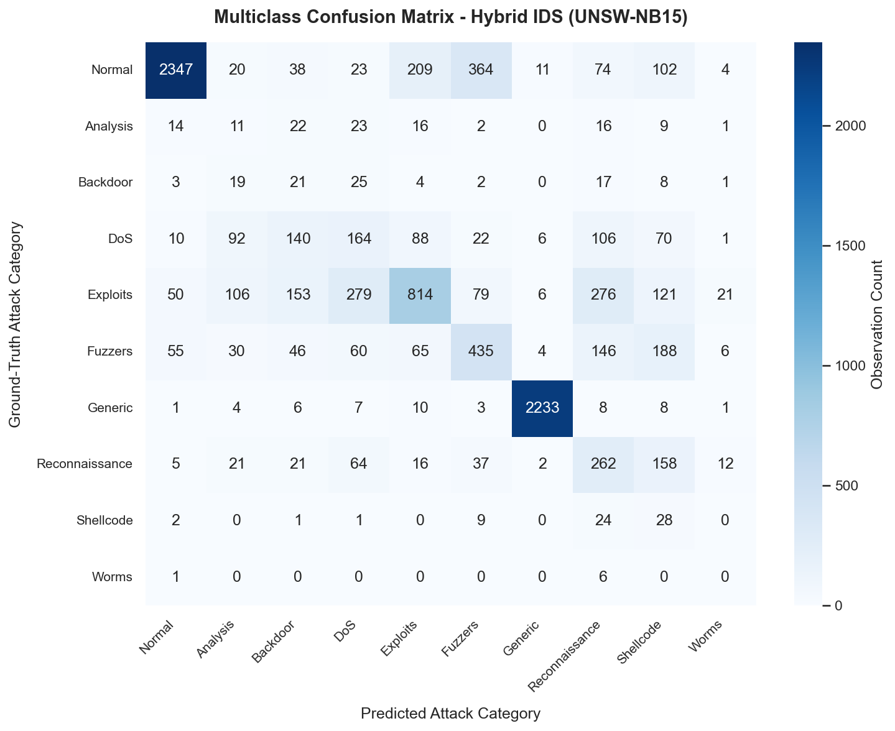

<div align="center">

# 🛡️ Explainable Hybrid Deep Learning-Based Network Intrusion Detection System

**A collaborative undergraduate deep learning project — classifying network intrusion attacks using CNN-BiLSTM-Attention with SHAP explainability, evaluated on UNSW-NB15.**

[](https://python.org)
[](https://pytorch.org)
[](https://keras.io)
[](https://streamlit.io)
[](https://shap.readthedocs.io)
[](https://scikit-learn.org)
[](LICENSE)

</div>

---

## 📌 Table of Contents

- [Project Overview](#-project-overview)
- [Problem Statement](#-problem-statement)
- [Project Objectives](#-project-objectives)
- [Key Features](#-key-features)
- [System Architecture](#-system-architecture)
- [Dataset](#-dataset)
- [Attack Categories](#-attack-categories)
- [Preprocessing](#-preprocessing-methodology)
- [Proposed Model](#-proposed-model)
- [Explainable AI — SHAP](#-explainable-ai--shap)
- [SOC Dashboard](#-soc-dashboard)
- [Experimental Setup](#-experimental-setup)
- [Results](#-results)
- [Visualisations](#-visualisations)
- [Installation](#-installation)
- [Running the Application](#-running-the-application)
- [Training the Model](#-training-the-model)
- [Running Tests](#-running-tests)
- [Project Structure](#-project-structure)
- [Limitations](#-limitations)
- [Future Work](#-future-work)
- [References](#-references)
- [Authors](#-authors)
- [Licence](#-licence)

---

## 🔎 Project Overview

Network Intrusion Detection Systems (IDS) are software tools that monitor network traffic and identify malicious activity. With cyberattacks growing in volume and sophistication, automated detection systems have become a critical component of network security.

This project implements a **hybrid deep learning IDS** that processes sequences of network flow records and classifies them into one of ten categories — nine attack types and normal traffic — using the publicly available **UNSW-NB15** benchmark dataset.

The system is designed around three learning objectives:

1. **Understand how deep learning architectures** (CNN, LSTM, Attention) can be combined to handle time-series network data.
2. **Learn how to handle real-world challenges** such as class imbalance, categorical features, and preprocessing pipelines in a machine learning project.
3. **Explore Explainable AI (XAI)** — using SHAP to understand what a black-box deep learning model is actually looking at when it makes a decision.

The project is deployed as an interactive **Streamlit SOC (Security Operations Centre) dashboard** for demonstration.

> **Scope note:** This is a research and learning implementation using pre-recorded benchmark data. It is not a production cybersecurity product and does not perform live network monitoring or offensive network operations.

---

## 🎯 Problem Statement

Traditional network IDS rely on manually written detection signatures (rules) that:
- Must be constantly updated as new attacks emerge.
- Cannot detect novel or slightly modified attack variants.
- Treat each network packet in isolation, ignoring the temporal flow of traffic.
- Provide no explanation for why a particular connection was flagged.

**Deep learning approaches** can learn complex, non-linear patterns from raw traffic features, capture temporal dependencies across consecutive flow records, and generalise to previously unseen attack patterns — but their predictions are typically opaque.

This project addresses both limitations: accuracy through deep learning, and transparency through SHAP explanations.

---

## 📋 Project Objectives

1. Implement a modular data preprocessing pipeline for the UNSW-NB15 dataset.
2. Build a hybrid **1D-CNN → BiLSTM → Attention** neural network for multiclass traffic classification.
3. Address the class imbalance problem using inverse-frequency class weighting.
4. Integrate SHAP to explain individual model predictions at the feature level.
5. Develop an interactive Streamlit dashboard for model demonstration.
6. Conduct an ablation study comparing baseline and proposed architectures.

---

## ✨ Key Features

| Feature | Implemented |
|:---|:---:|
| 10-class multiclass attack classification | ✅ |
| UNSW-NB15 benchmark dataset pipeline | ✅ |
| Sliding-window sequence construction (T = 5) | ✅ |
| 1D-CNN spatial feature extraction | ✅ |
| Bidirectional LSTM temporal learning | ✅ |
| Trainable additive temporal attention mechanism | ✅ |
| Inverse-frequency class-weighted training | ✅ |
| SHAP Permutation Explainer (time-step aggregated) | ✅ |
| DoS attack primary demonstration | ✅ |
| 8-page interactive SOC Streamlit dashboard | ✅ |
| Ablation study — 5 architectures compared | ✅ |
| Sequence-length sensitivity study (T ∈ {3, 5, 10}) | ✅ |
| Forensic incident history and CSV export | ✅ |
| Leakage-free modular preprocessing pipeline | ✅ |
| Unit test suite (5 test modules) | ✅ |

---

## 🏗️ System Architecture

```mermaid
flowchart TD
    A["📂 UNSW-NB15 Dataset\n82,332 training · 175,341 testing records\n45 original columns"]
    B["🔧 Data Cleaning\nWhitespace stripping · Category standardisation\nMedian imputation (train-fitted) · Inf → NaN"]
    C["🔢 Feature Engineering\nCategorical encoding: proto, service, state\nStandard scaling: 39 numerical features\n42 total model input features"]
    D["📦 Sequence Construction\nSliding window, stride = 1, T = 5\nOutput shape: B × 5 × 42\nLabel = final observation in each window"]
    E["🧱 1D-CNN Block\nConv1D · 64 filters · kernel=3 · same padding · ReLU\nBatch Normalisation · Dropout(0.25)"]
    F["🔄 Bidirectional LSTM\n64 units forward + 64 units backward\nreturn_sequences=True · internal dropout=0.2\nOutput: B × 5 × 128"]
    G["🎯 Temporal Attention\nProjection → tanh → alignment scores\nSoftmax over time axis → weights α₁…α₅\nContext C = Σ αt · ht  → B × 128"]
    H["🔗 Dense Head\nDense(64, ReLU) · Batch Norm · Dropout(0.25)"]
    I["📊 10-Class Softmax\nNormal · Analysis · Backdoor · DoS\nExploits · Fuzzers · Generic\nReconnaissance · Shellcode · Worms"]
    J["🚨 Prediction\nAttack class · Confidence · Severity · SOC Alert"]
    SHAP1["🔬 SHAP Explainer\nshap.Explainer on flattened sequence\n50 background training samples"]
    SHAP2["📈 Feature Attributions\nφ_i = Σ_t φ_{i,t}  summed across T steps\nTop positive + negative drivers"]
    DASH["🖥️ Streamlit SOC Dashboard\nhttp://localhost:8501  ·  8 pages"]

    A --> B --> C --> D --> E --> F --> G --> H --> I --> J
    J --> SHAP1 --> SHAP2 --> DASH
    J --> DASH
```



---

## 📂 Dataset

This project uses the **UNSW-NB15** benchmark dataset, created by the Australian Centre for Cyber Security (ACCS) at UNSW Canberra. It captures real and synthetically generated network traffic across nine attack categories.

### Verified File Statistics

> *Record counts verified by directly reading the local CSV files.*

| Property | Training File | Testing File |
|:---|:---:|:---:|
| **Filename** | `UNSW_NB15_training-set.csv` | `UNSW_NB15_testing-set.csv` |
| **Records** | **82,332** | **175,341** |
| **Columns** | 45 | 45 |
| **Missing values** | 0 | 0 |
| **Duplicate rows** | 0 | 0 |

> **Note on the split:** The official UNSW-NB15 pre-split files have a larger testing set (175,341) than training set (82,332). This is intentional by the dataset authors, who designed the split for evaluation on a broader range of attack instances.

### Feature Schema

| Column | Type | Role |
|:---|:---|:---|
| `id` | int | Record identifier — **excluded from model** |
| `attack_cat` | str | Attack category — **target label (multiclass)** |
| `label` | int | Binary flag 0=Normal/1=Attack — **excluded from model** |
| `proto` | str | Network protocol — **categorical, encoded** |
| `service` | str | Destination service — **categorical, encoded** |
| `state` | str | Connection state — **categorical, encoded** |
| *(39 others)* | float/int | Numerical flow statistics — **standard-scaled** |

**Model input:** 42 features (3 encoded categoricals + 39 numericals). The 3 identifier/label columns are never passed to the model.

> **Dataset files are not included in this repository.** See [`dataset/README.md`](dataset/README.md) for download instructions.
> Official source: https://research.unsw.edu.au/projects/unsw-nb15-dataset

### Training Set Class Distribution

| Class | Train Records | Test Records |
|:---|---:|---:|
| Normal | 37,000 | 56,000 |
| Generic | 18,871 | 40,000 |
| Exploits | 11,132 | 33,393 |
| Fuzzers | 6,062 | 18,184 |
| **DoS** ⭐ | **4,089** | **12,264** |
| Reconnaissance | 3,496 | 10,491 |
| Analysis | 677 | 2,000 |
| Backdoor | 583 | 1,746 |
| Shellcode | 378 | 1,133 |
| Worms | 44 | 130 |

---

## 🎯 Attack Categories

| ID | Category | Description |
|:---:|:---|:---|
| 0 | Normal | Legitimate network traffic |
| 1 | Analysis | Port scanning, vulnerability probing, banner grabbing |
| 2 | Backdoor | Covert C2 channels, persistent unauthorised access |
| **3** | **DoS** ⭐ | **Volumetric flooding, resource exhaustion (primary demo attack)** |
| 4 | Exploits | Known CVE exploitation, buffer overflows |
| 5 | Fuzzers | Randomised boundary-condition probing |
| 6 | Generic | Protocol-level violations, cipher attacks |
| 7 | Reconnaissance | Network topology mapping, host profiling |
| 8 | Shellcode | Executable shell injection, payload staging |
| 9 | Worms | Autonomous self-propagating malware |

---

## 🔧 Preprocessing Methodology

The preprocessing pipeline is carefully designed to prevent **data leakage** — all fitting steps use training data only, and transformations are then applied identically to testing data.

| Step | Operation | Leakage-Safe? |
|:---|:---|:---:|
| 1. Cleaning | Whitespace strip, category synonym normalisation, `Inf → NaN` | — |
| 2. Imputation | Median computed on **training data only** → applied to test | ✅ |
| 3. Categorical encoding | Maps fitted on **training data only** → unknown test values → `unknown_index` | ✅ |
| 4. Standard scaling | `StandardScaler` fitted on **training features only** → applied to test | ✅ |
| 5. Target encoding | Fixed 10-class mapping (no fitting required) | ✅ |
| 6. Sequence construction | Training and testing windows built **independently** | ✅ |

---

## 🧠 Proposed Model

### Input Shape

```
(B, 5, 42)
   B  = batch size
   5  = sequence length T (five consecutive network observations)
   42 = number of preprocessed features per observation
```

### Architecture (verified against `models/hybrid_model.py`)

#### Layer 1 — 1D Convolutional Block

```
Conv1D(filters=64, kernel_size=3, padding="same", activation="relu")
  → Batch Normalisation
  → Dropout(rate=0.25)
Output shape: (B, 5, 64)
```

**What it does:** Slides 64 learnable filters across the 5-step sequence, detecting local co-activation patterns between adjacent network flow features (e.g., byte counts + packet rates + connection counts).

#### Layer 2 — Bidirectional LSTM

```
Bidirectional(LSTM(units=64, return_sequences=True, dropout=0.2))
  Forward:  h_t^fwd   64 units
  Backward: h_t^bwd   64 units
  Combined: h_t = [h_t^fwd ∥ h_t^bwd]
Output shape: (B, 5, 128)
```

**What it does:** Learns how traffic evolves over time — both forward (escalation of an attack) and backward (aftermath). Keeping all 5 hidden states (`return_sequences=True`) feeds the attention layer.

#### Layer 3 — Trainable Temporal Attention

The attention mechanism assigns a learned importance weight to each of the 5 time steps:

$$e_t = \mathbf{v}^\top \tanh(\mathbf{W}\, \mathbf{h}_t + \mathbf{b})$$

$$\alpha_t = \frac{\exp(e_t)}{\displaystyle\sum_{j=1}^{T} \exp(e_j)}$$

$$\mathbf{C} = \sum_{t=1}^{T} \alpha_t\, \mathbf{h}_t$$

```
Trainable weights: W ∈ ℝ^{128×128},  b ∈ ℝ^{128},  v ∈ ℝ^{128×1}
Outputs:  context vector C of shape (B, 128)
          optionally: attention weights α ∈ ℝ^{B×5} for visualisation
```

**What it does:** Not every observation in a sequence is equally important. For a DoS attack, the final observation (peak flood) usually receives the highest weight. The attention weights can be plotted in the dashboard to show *which time step* the model focused on.

#### Layer 4 — Classification Head

```
Dense(64, activation="relu")
  → Batch Normalisation
  → Dropout(rate=0.25)
  → Dense(10, activation="softmax")
Output shape: (B, 10)  — class probabilities
```

#### Class Imbalance Handling

The dataset is severely imbalanced (Worms: 44 training samples vs Normal: 37,000). The training pipeline computes inverse-frequency class weights:

$$w_c = \frac{N}{K \cdot N_c}$$

where $N$ = total training samples, $K = 10$, $N_c$ = count of class $c$. Minority classes receive proportionally higher loss contribution during training.

#### Training Configuration

| Hyperparameter | Value |
|:---|:---|
| Sequence length (T) | 5 |
| Batch size | 128 |
| Max epochs | 15 |
| Learning rate | 0.001 |
| CNN filters | 64 |
| LSTM units | 64 (each direction) |
| Dense units | 64 |
| Dropout rate | 0.25 |
| Optimiser | Adam |
| Loss | Categorical cross-entropy |
| Early stopping patience | 4 (monitors `val_loss`) |
| LR scheduler patience | 2 (factor 0.5, min 1×10⁻⁵) |
| Class weighting | ✅ Enabled |

---

## 🔬 Explainable AI — SHAP

One of the core learning objectives of this project is making the deep learning model **interpretable** — showing *why* it classified a network flow as an attack, not just *that* it did.

### What is SHAP?

SHAP (SHapley Additive exPlanations) assigns each input feature a signed **contribution score** to the model's prediction, based on cooperative game theory. For a prediction $f(x)$:

$$f(x) = \phi_0 + \sum_{i=1}^{D} \phi_i$$

where $\phi_i$ is the Shapley value of feature $i$ — its average marginal contribution across all possible feature coalitions. Positive values push toward the predicted class; negative values push away.

### Implementation Details

| Aspect | Detail |
|:---|:---|
| Explainer | `shap.Explainer` (generic interface — Permutation/Kernel behaviour) |
| Input handling | 3D sequence `(1, T, D)` flattened to `(1, T×D)` for the explainer |
| Background | 50 representative training samples |
| Time aggregation | SHAP values reshaped to `(T, D)` and **summed across T=5 steps** per feature |
| Output | Signed per-feature attribution for the predicted class |

### Temporal Attention vs SHAP — An Important Distinction

These two mechanisms are **complementary, not interchangeable**:

| | Temporal Attention (α₁…α₅) | SHAP (φ₁…φ₄₂) |
|:---|:---|:---|
| **Question answered** | *When?* Which time step matters most | *What?* Which features drove the decision |
| **Dimension** | Across the 5 time steps | Across the 42 input features |
| **How it's computed** | Learned during model training | Computed post-hoc on the trained model |
| **Example** | "The model focused 42% of attention on observation 5" | "`sbytes` increased DoS risk by +0.18; `dur` decreased it by −0.07" |

> Attention weights show *when* the model looked; SHAP shows *what* it was looking at. Neither alone is a complete explanation.

---

## 🖥️ SOC Dashboard

An 8-page **Security Operations Centre (SOC)** dashboard built with Streamlit.

| # | Page | What it shows |
|:---:|:---|:---|
| 1 | 🛡️ SOC Command Overview | Global KPI counters, threat distribution donut chart, live incident feed |
| 2 | 📁 Dataset Explorer | Dataset preview, class frequency charts, schema info, missing value diagnostics |
| 3 | ⚡ Model Training | Hyperparameter controls, training runner, live loss/accuracy curves |
| 4 | 🎯 Attack Detection (Demo) | Interactive detection with DoS benchmark samples; alert banner, probability bar chart, attention weights chart |
| 5 | 🔬 Explainable AI (SHAP) | Per-prediction SHAP bar chart, feature-impact table with domain context, analyst brief |
| 6 | 📊 Model Performance | Confusion matrix, per-class metrics table, ablation comparison chart, sequence-length study chart |
| 7 | 🚨 Incident History | Forensic audit log, severity-level filters, CSV export |
| 8 | ℹ️ System Architecture | Architecture diagrams, mathematical formulas, environment specifications |

**Launch:**
```bash
python -m streamlit run app.py
```
Then open: **http://localhost:8501**

---

## 🧪 Experimental Setup

### Main Model Evaluation
- **Training data:** `UNSW_NB15_training-set.csv` (82,332 records)
- **Test data:** `UNSW_NB15_testing-set.csv` (175,341 records; 9,996 sequences sampled)
- **Sequence length:** T = 5, stride = 1
- **Training:** Full pipeline, class weighting enabled, 15 epochs, batch size 128
- **Evaluation:** Held-out test sequences; no data seen during training

### Ablation Study
- **Architectures compared:** 5 (see results table)
- **Data:** Stratified subsample (~6,000 test sequences)
- **Note:** Faster training configuration; results directionally comparable but not identical to main evaluation due to smaller sample size and shorter training

### Sequence Length Study
- **Values tested:** T ∈ {3, 5, 10}
- **Data:** Stratified subsamples (~6,000 test sequences per T)
- **Note:** Independent quick-training runs; not directly comparable to main evaluation metrics

---

## 📊 Results

> All numbers are sourced from verified result files (`results/reports/evaluation_results.json`, `results/experiment_results/`). Nothing has been estimated or manually adjusted.

### Main Model — Proposed Hybrid CNN-BiLSTM-Attention

| Metric | Value |
|:---|:---:|
| **Overall Accuracy** | **63.18%** |
| Macro Precision | 37.11% |
| Macro Recall | 39.72% |
| **Macro F1-Score** | **35.57%** |
| Weighted Precision | 73.64% |
| Weighted Recall | 63.18% |
| **Weighted F1-Score** | **67.21%** |
| Test sequences | 9,996 |
| Training time | 126.3 s (15 epochs) |
| Model size | 1.21 MB |
| Inference latency | 0.167 ms / sequence |

### Per-Class Results

| Category | Precision | Recall | F1 | Support |
|:---|:---:|:---:|:---:|---:|
| Normal | 94.33% | 73.53% | 82.64% | 3,192 |
| Analysis | 3.63% | 9.65% | 5.28% | 114 |
| Backdoor | 4.69% | 21.00% | 7.66% | 100 |
| **DoS** ⭐ | **25.39%** | **23.46%** | **24.39%** | **699** |
| Exploits | 66.61% | 42.73% | 52.06% | 1,905 |
| Fuzzers | 45.65% | 42.03% | 43.76% | 1,035 |
| Generic | 98.72% | 97.90% | 98.31% | 2,281 |
| Reconnaissance | 28.02% | 43.81% | 34.18% | 598 |
| Shellcode | 4.05% | 43.08% | 7.40% | 65 |
| Worms | 0.00% | 0.00% | 0.00% | 7 |

> **Why are some minority classes so low?** Worms has only 44 training samples vs 37,000 Normal samples — a ratio of 840:1. Even with class weighting, this level of imbalance is a fundamental dataset challenge. This is discussed further in [Limitations](#-limitations).

### Ablation Study (5 Architectures, subsample ~6,000 sequences)

| Architecture | Accuracy | Macro F1 | Weighted F1 |
|:---|:---:|:---:|:---:|
| 1. CNN only (baseline) | 54.45% | 16.03% | 41.78% |
| 2. BiLSTM only (baseline) | 60.92% | 21.83% | 52.42% |
| 3. CNN + BiLSTM (baseline) | 62.44% | 23.44% | 54.70% |
| 4. CNN + BiLSTM + Attention (no class weighting) | 58.02% | 19.31% | 48.13% |
| **5. Proposed: CNN + BiLSTM + Attention + Class Weighting** | 34.12%† | 18.52%† | 36.75%† |

> †The ablation run for architecture 5 used a different random subsample and shorter training than the full evaluation. The definitive result for the proposed model is the **main evaluation above (63.18% accuracy, 35.57% macro F1)**.

### Sequence Length Study (subsample ~6,000 sequences per T)

| Sequence Length | Accuracy | Macro F1 |
|:---:|:---:|:---:|
| T = 3 | 45.15% | 24.68% |
| T = 5 *(selected)* | 34.22% | 18.62% |
| T = 10 | 30.11% | 16.80% |

> These runs used independent quick-training configurations. T = 5 was selected as the design choice for the main model.

---

## 🖼️ Visualisations

### Confusion Matrix


### Training Convergence Curves


### SHAP Global Feature Importance


### Ablation Study — Architecture Comparison


### Sequence Length Sensitivity


---

## ⚙️ Installation

### Prerequisites

- Python 3.10 or higher
- Git

### Step 1 — Clone

```bash
git clone https://github.com/norriy0u/Explainable-Hybrid-Deep-Learning-IDS.git
cd Explainable-Hybrid-Deep-Learning-IDS
```

### Step 2 — Virtual Environment

```bash
# Windows
python -m venv venv
venv\Scripts\activate

# Linux / macOS
python3 -m venv venv
source venv/bin/activate
```

### Step 3 — Install Dependencies

```bash
pip install --upgrade pip
pip install -r requirements.txt
```

> **Framework note:** This project uses **PyTorch** as the Keras 3 backend. No TensorFlow needed. The `requirements.txt` pulls CPU-only PyTorch by default. For GPU support, install a CUDA-enabled PyTorch wheel from https://pytorch.org/get-started/locally/ *before* `pip install -r requirements.txt`.

### Step 4 — Place the Dataset

```
dataset/
├── UNSW_NB15_training-set.csv   ← 82,332 records
└── UNSW_NB15_testing-set.csv    ← 175,341 records
```

Download from: https://research.unsw.edu.au/projects/unsw-nb15-dataset  
See [`dataset/README.md`](dataset/README.md) for detailed instructions.

### Step 5 — Windows Application Control (Smart App Control) Note

On Windows 11 systems with **Smart App Control / Application Control** enabled, newly downloaded unsigned `.pyd`/`.dll` native wheels inside freshly created virtual environments (for example, `ml_dtypes/_ml_dtypes_ext` or `shap` inside `.venv313`) may trigger:

```text
ImportError: DLL load failed while importing _ml_dtypes_ext: An Application Control policy has blocked this file.
```

**Safe Resolution (Do NOT disable Windows security):**
- Use the verified local Python 3.14 interpreter (`C:\Python314\python.exe`) where all 13 required libraries (`numpy`, `pandas`, `scikit-learn`, `ml_dtypes`, `torch`, `keras`, `shap`, `plotly`, `streamlit`) load cleanly under Windows Application Control.
- `.vscode/settings.json` is pre-configured to select `C:\Python314\python.exe` automatically when opening `Explainable_Hybrid_IDS_Final` in VS Code.
- For cloud/Linux execution without Windows Application Control restrictions, the project also runs directly on **Streamlit Community Cloud** or **WSL2 / Ubuntu**.

---

## 🚀 Running the Application (VS Code & Local Windows)

### Option A — One-Click Windows Launcher (Recommended)
Double-click **`run_app.bat`** inside `Explainable_Hybrid_IDS_Final/`, or run in PowerShell:

```powershell
.\run_app.ps1
```

### Option B — Run Manually in VS Code Terminal

```powershell
$env:KERAS_BACKEND = "torch"
C:\Python314\python.exe -m streamlit run app.py
```

Open: **http://localhost:8501**

> A pre-trained model (`artifacts/models/hybrid_ids_model.keras`) and fitted preprocessor (`artifacts/preprocessors/preprocessing_pipeline.joblib`) are included. All 8 dashboard pages — including live Attack Detection, genuine Temporal Attention weights, and SHAP Explainability — work immediately without retraining.

---

## 🏋️ Training the Model

### Via Dashboard

1. Go to **⚡ Model Training** in the sidebar.
2. Set hyperparameters.
3. Click **Train Model**.
4. Training curves update live.
5. Artifacts saved automatically to `artifacts/`.

### Via Command Line

```bash
# Full training on complete dataset
python training/train_model.py

# Quick subsample training (~15,000 records, for testing)
python training/train_model.py --quick

# Ablation study (all 5 architectures)
python training/baseline_models.py
```

---

## 🧪 Running Tests

```bash
# Run all tests
python -m pytest tests/ -v

# Or run individually
python tests/test_preprocessing.py
python tests/test_sequences.py
python tests/test_model.py
python tests/test_prediction.py
python tests/test_explainability.py
```

| Test Module | Coverage | Status |
|:---|:---|:---:|
| `test_preprocessing.py` | Category standardisation, encoding, scaling | ✅ |
| `test_sequences.py` | Sliding window shape, single-sample replication | ✅ |
| `test_model.py` | Architecture shapes, attention output | ✅* |
| `test_prediction.py` | End-to-end inference, alert schema | ✅ |
| `test_explainability.py` | SHAP explainer, domain mappings | ✅ |

> *On some Windows environments, `test_model.py` may fail at import with a `PermissionError` on `~/.keras/keras.json`. This is a file-system permission issue, not a model code problem.

---

## 🗂️ Project Structure

```
Explainable-Hybrid-Deep-Learning-IDS/
│
├── 📄 app.py                          # Streamlit 8-page SOC dashboard entrypoint
├── 📄 requirements.txt                # Python dependency manifest
├── 📄 README.md                       # This file
├── 📄 LICENSE                         # MIT Licence
├── 📄 CONTRIBUTING.md                 # Contribution and collaboration guide
├── 📄 CITATION.cff                    # Academic citation metadata
├── 📄 .gitignore                      # Excludes datasets, caches, venvs
│
├── 📁 config/
│   └── config.py                      # Hyperparameters, class mappings, paths
│
├── 📁 dataset/
│   ├── README.md                      # Download instructions and schema
│   ├── NUSW-NB15_features.csv         # Feature specification (included)
│   ├── UNSW_NB15_training-set.csv     # ⚠️ NOT committed — download separately
│   └── UNSW_NB15_testing-set.csv      # ⚠️ NOT committed — download separately
│
├── 📁 preprocessing/
│   ├── load_dataset.py                # CSV loader and schema validator
│   ├── clean_data.py                  # Data cleaning pipeline
│   ├── encode_features.py             # Train-fitted categorical and target encoders
│   ├── feature_scaling.py             # Train-fitted StandardScaler
│   ├── sequence_builder.py            # Sliding window constructor (T=5, stride=1)
│   └── pipeline.py                    # End-to-end coordinator with joblib persistence
│
├── 📁 models/
│   ├── attention.py                   # Trainable TemporalAttention Keras layer
│   ├── cnn_model.py                   # Baseline 1: 1D-CNN
│   ├── bilstm_model.py                # Baseline 2: BiLSTM
│   ├── cnn_bilstm.py                  # Baseline 3: CNN + BiLSTM
│   └── hybrid_model.py                # Proposed: CNN + BiLSTM + Attention
│
├── 📁 training/
│   ├── class_weights.py               # Inverse-frequency class weight computation
│   ├── evaluate_model.py              # Multi-metric evaluator and confusion matrix
│   ├── train_model.py                 # Training engine (EarlyStopping, ReduceLROnPlateau)
│   └── baseline_models.py             # Ablation study runner (5 architectures)
│
├── 📁 explainability/
│   ├── shap_explainer.py              # SHAP Permutation Explainer + time-step aggregation
│   └── feature_visualization.py       # Matplotlib and Plotly attribution charts
│
├── 📁 detection/
│   ├── alert_generator.py             # SOC incident builder with response playbooks
│   ├── detection_history.py           # Audit log, filters, CSV export
│   └── predict_attack.py              # AttackDetectionEngine — end-to-end inference
│
├── 📁 dashboard/
│   ├── styles.py                      # Dark SOC CSS theme
│   ├── overview.py                    # Page 1: Command Centre
│   ├── dataset_explorer.py            # Page 2: Dataset Explorer
│   ├── training.py                    # Page 3: Model Training
│   ├── detection.py                   # Page 4: Attack Detection (DoS demo)
│   ├── explainability.py              # Page 5: SHAP Explainability
│   ├── performance.py                 # Page 6: Model Performance
│   ├── alerts.py                      # Page 7: Incident History
│   └── system_info.py                 # Page 8: System Architecture
│
├── 📁 utils/
│   ├── logger.py                      # Thread-safe console/file logger
│   └── helpers.py                     # JSON/NumPy metric serialisers
│
├── 📁 tests/
│   ├── test_preprocessing.py
│   ├── test_sequences.py
│   ├── test_model.py
│   ├── test_prediction.py
│   └── test_explainability.py
│
├── 📁 artifacts/
│   ├── models/hybrid_ids_model.keras           # Pre-trained model (1.21 MB)
│   └── preprocessors/preprocessing_pipeline.joblib
│
├── 📁 results/
│   ├── plots/                         # Training curves, confusion matrix, comparisons
│   ├── shap_plots/                    # SHAP global summary
│   ├── reports/                       # Evaluation JSON, classification report
│   └── experiment_results/            # Ablation and sequence-length JSONs
│
└── 📁 docs/
    └── images/                        # Plots for README display
```

---

## ⚠️ Limitations

| Limitation | Detail |
|:---|:---|
| **Severe class imbalance** | Worms (44 train samples) and Shellcode (378) are under-represented. Even with class weighting, Worms achieves 0% F1. This is a dataset constraint, not a model failure. |
| **File-order sequences** | Sliding windows use the original file order, not genuine packet timestamps. The sequences approximate temporal flow but are not guaranteed to be temporally continuous. |
| **Offline evaluation only** | The model is evaluated on pre-recorded benchmark data. Real-time network monitoring is not implemented. |
| **Dataset specificity** | Trained and evaluated on UNSW-NB15 only. Generalisation to other network environments is untested. |
| **SHAP computation time** | The permutation explainer is computationally slow for large inputs. Explanation takes several seconds per sample in the dashboard. |
| **Dashboard scope** | The Streamlit interface is a learning demonstration, not a production SOC tool. It has no authentication, multi-user support, or enterprise integrations. |

---

## 🔭 Future Work

Possible extensions identified during the project:

- **Real-time packet capture** — integrate Scapy or PyShark for live inference.
- **True temporal sequences** — reconstruct genuine flow sequences using UNSW-NB15 timestamps or connection identifiers.
- **Additional datasets** — evaluate on CIC-IDS-2018, NSL-KDD for cross-dataset generalisation.
- **Improved minority-class detection** — explore focal loss, prototype networks, or generative augmentation.
- **Transformer attention** — replace additive attention with multi-head self-attention.
- **REST API** — FastAPI endpoint for integration with real SIEM platforms.
- **Containerisation** — Docker for reproducible single-command setup.
- **Additional XAI** — LIME or Integrated Gradients alongside SHAP.

---

## 📚 References

### Dataset

```bibtex
@inproceedings{moustafa2015unsw,
  title     = {UNSW-NB15: a comprehensive data set for network intrusion detection systems},
  author    = {Moustafa, Nour and Slay, Jill},
  booktitle = {2015 Military Communications and Information Systems Conference (MilCIS)},
  pages     = {1--6},
  year      = {2015},
  organization = {IEEE},
  doi       = {10.1109/MilCIS.2015.7348948}
}
```

### Explainable AI

```bibtex
@inproceedings{lundberg2017unified,
  title     = {A unified approach to interpreting model predictions},
  author    = {Lundberg, Scott M and Lee, Su-In},
  booktitle = {Advances in Neural Information Processing Systems},
  volume    = {30},
  year      = {2017}
}
```

### Core Methods

- Hochreiter, S. & Schmidhuber, J. (1997). Long Short-Term Memory. *Neural Computation*, 9(8), 1735–1780.
- Bahdanau, D., Cho, K. & Bengio, Y. (2015). Neural Machine Translation by Jointly Learning to Align and Translate. arXiv:1409.0473.
- LeCun, Y., Bottou, L., Bengio, Y. & Haffner, P. (1998). Gradient-based learning applied to document recognition. *Proceedings of the IEEE*, 86(11), 2278–2324.
- Ferrag, M. A. et al. (2020). Deep Learning for Cyber Security Intrusion Detection. *Journal of Information Security and Applications*, 50, 102419.

---

## 👥 Authors

- **Midhila M** — [@midhila2106-cmd](https://github.com/midhila2106-cmd)
- **Amrita Raj** — [@norriy0u](https://github.com/norriy0u)

*Third-Year Undergraduate Engineering Project · 5th Semester Deep Learning Elective*

---

## 📜 Licence

MIT — see [LICENSE](LICENSE).

The **UNSW-NB15 dataset** is the intellectual property of UNSW Canberra / ACCS and is used here strictly for academic learning purposes. See: https://research.unsw.edu.au/projects/unsw-nb15-dataset
